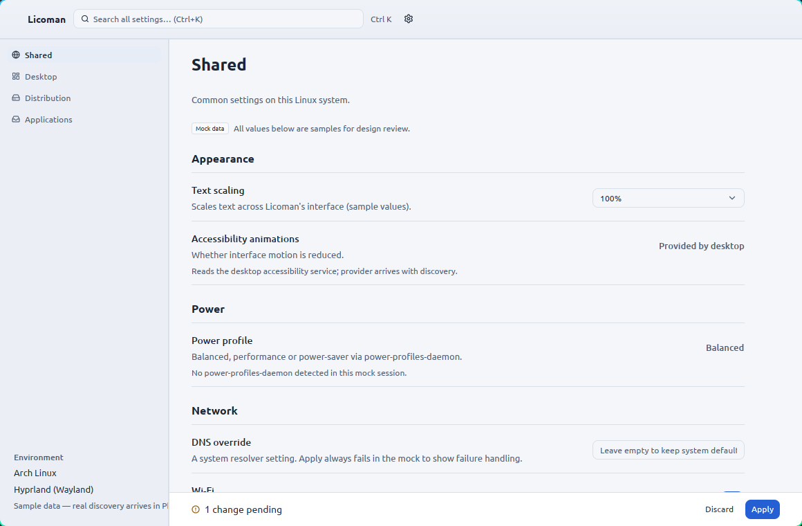

<p align="center">
  <picture>
    <source media="(prefers-color-scheme: dark)" srcset="assets/branding/mark/dark/licoman-mark-256.png">
    
  </picture>
</p>

<h1 align="center">Licoman</h1>

<p align="center">
  <strong>Li</strong>nux <strong>Co</strong>nfiguration <strong>Man</strong>ager —
  a universal interface for Linux configuration.
</p>

<p align="center">
  <a href="CHANGELOG.md">Changelog</a> ·
  <a href="docs/installation.md">Installation</a> ·
  <a href="docs/usage.md">Usage</a> ·
  <a href="docs/compatibility.md">Compatibility</a> ·
  <a href="CONTRIBUTING.md">Contributing</a> ·
  <a href="LICENSE">License</a>
</p>

<p align="center">
  <a href="LICENSE"></a>
  <a href="CHANGELOG.md"></a>
  
  
</p>

---

One native desktop application over shared/system, desktop-environment,
distribution and installed-application settings. Built with
**Rust + GPUI + GPUI Kit** — no Electron, no browser UI, no embedded web view.

Licoman reads your **actual effective configuration** — native configuration
files, GSettings/dconf, D-Bus services, Xfconf — and offers typed, validated,
backed-up writes through a safe write engine. It is an interface, not a
store: your existing configuration remains authoritative, and nothing is
changed without an explicit action from you.

> **Status:** pre-release (0.1.0-alpha.0 release candidate — see the
> [changelog](CHANGELOG.md)). Published packages do not exist yet; build
> from source below.

## Screenshot

<p align="center">
  <picture>
    <source media="(prefers-color-scheme: dark)" srcset="docs/screenshots/main-window-dark.png">
    
  </picture>
</p>

## Features

- **Four scopes, one window** — Shared/system capabilities, Desktop
  environment settings (GNOME/GSettings, Xfce/Xfconf, Hyprland diagnostics),
  Distribution information, and an Applications view — all rendered in the
  same window with slide transitions between content views. Every
  unsupported target stays visible with an honest integration-status
  explanation.
- **Real read backends** — GSettings/dconf (schema defaults, dconf
  precedence), configuration files (TOML with documented import merge,
  mpv's grammar), D-Bus services (power-profiles-daemon), Xfconf channels
  (read-only), compositor diagnostics over the documented Hyprland IPC.
- **Safe write engine** — core-derived policies, value validation before
  I/O, fingerprint + semantic conflict checks, xattr/ACL preserve-or-refuse,
  bounded private backups, atomic staged writes with fsync and readback
  verification with automatic restore. Every write requires an explicit
  **Apply**; high-risk rows ask for confirmation naming effect and target.
- **Provenance on every row** — where the current value came from (*Set by
  you*, *Default*, *Live service state*, *Managed by your system*) plus a
  **Source details** view. Unknown or unreadable is shown as unavailable —
  never guessed.
- **Global search palette** (`Ctrl+K`) across all scopes and applications,
  served from a pre-computed index — well under a millisecond at 1,000+
  settings; virtualized rendering verified at 1,240 synthetic settings.
- **Quiet Control design system** — native Dark, Light and System themes
  applied to every window immediately; keyboard-reachable interface.
- **Privacy by construction** — no telemetry, no network access, no daemon,
  no idle polling; logs carry identifiers and outcomes, never setting values.
- **Data-only module system** — settings integrations are declarative TOML
  manifests behind a closed backend allowlist (no shell payloads), with a
  JSON Schema and a manifest linter (`licoman module schema`, `licoman
  module validate`). See [modules/README.md](modules/README.md).

## Principles (non-negotiable)

1. Existing configuration remains authoritative — Licoman is an interface, not a store.
2. UI-independent core (`crates/core` has no GUI dependency, enforced by the build).
3. Least privilege; the GUI always runs unprivileged.
4. Fail closed: unknown → unavailable/read-only, never a guess.
5. No arbitrary scripting from manifests.
6. Version-aware support across distro / session / DE / app dimensions.
7. Truthful UI states (read-only, dirty, applying, failed, external change…).
8. Licoman's own theme preference never touches OS appearance settings.
9. No baseline telemetry.
10. No version bumps by guesswork.

## Installation

Requirements: Linux x86_64, a Wayland or X11 session with a working Vulkan
user-space stack (loader + a GPU driver), glib/gio (present on every desktop
Linux system), fontconfig fonts. Without a graphical session the binary
exits with a readable diagnostic. Details and troubleshooting:
[docs/installation.md](docs/installation.md),
[docs/troubleshooting.md](docs/troubleshooting.md).

### Arch package

The repository ships a [PKGBUILD](packaging/licoman/PKGBUILD) (the tested
packaging target). Build it from a release tarball (`git archive` of the
release tag):

```sh
makepkg -ef
sudo pacman -U licoman-0.1.0-1-x86_64.pkg.tar.zst
```

The package installs `/usr/bin/licoman`, the launcher, hicolor icons,
AppStream metadata and license notices; uninstalling removes only those
package-owned files. No `.deb` or `.rpm` packages exist yet — placeholder
packages are deliberately not shipped.

### Manual installation (build from source)

Build requirements: a stable Rust toolchain (edition 2024 — e.g. via
[rustup](https://rustup.rs)), `pkg-config`, and the gpui Linux build
dependencies (clang, fontconfig, wayland, webkit2gtk-4.1, libxkbcommon-x11,
libx11-xcb, alsa, OpenSSL, zstd, Vulkan, glib — exact package lists for
Debian/Ubuntu and Arch are in
[docs/installation.md](docs/installation.md)).

```sh
git clone https://github.com/barscn/licoman
cd licoman
cargo build --release --locked
```

Run it in place:

```sh
./target/release/licoman
```

Or install the binary system-wide (plus, optionally, the desktop launcher,
AppStream metadata and icon):

```sh
sudo install -Dm755 target/release/licoman /usr/local/bin/licoman

# optional desktop integration
sudo install -Dm644 packaging/desktop/io.github.barscn.Licoman.desktop \
  /usr/share/applications/io.github.barscn.Licoman.desktop
sudo install -Dm644 packaging/metainfo/io.github.barscn.Licoman.metainfo.xml \
  /usr/share/metainfo/io.github.barscn.Licoman.metainfo.xml
sudo install -Dm644 assets/icons/hicolor/scalable/apps/io.github.barscn.Licoman.svg \
  /usr/share/icons/hicolor/scalable/apps/io.github.barscn.Licoman.svg
```

Your Licoman preferences live in `$XDG_CONFIG_HOME/licoman` and any backups
it made in `$XDG_DATA_HOME/licoman`; removing the binary never touches them.

## Usage

Launch `licoman` from your application menu or a terminal. Discovery runs at
startup and stays passive; every change is staged until you press **Apply**.
See [docs/usage.md](docs/usage.md) for a walkthrough (scopes, editing,
search, themes) and [docs/configuration-safety.md](docs/configuration-safety.md)
for what happens on an apply.

Headless, read-only commands:

```sh
licoman --diagnostics          # redacted environment export
licoman module validate <path> # module manifest linter
licoman module schema          # JSON Schema for module authors
```

## Documentation

| Document | Contents |
|---|---|
| [docs/installation.md](docs/installation.md) | Requirements, packages, build-from-source, first run |
| [docs/usage.md](docs/usage.md) | Windows, scopes, editing, search, themes, keyboard |
| [docs/compatibility.md](docs/compatibility.md) | What is actually tested, per environment — only demonstrated claims |
| [docs/configuration-safety.md](docs/configuration-safety.md) | The write pipeline contract (validation, conflicts, backups) |
| [docs/privacy.md](docs/privacy.md) | Data flow, logging, what never leaves the machine |
| [docs/troubleshooting.md](docs/troubleshooting.md) | Session/Vulkan startup diagnostics |
| [docs/architecture/](docs/architecture/) | Crate boundaries, discovery, backends, write engine, decision records |
| [docs/security/](docs/security/) | Threat model, module trust |
| [docs/design/](docs/design/) | The Quiet Control design system |
| [modules/README.md](modules/README.md) | Writing a settings module (data-only TOML, no Rust) |

## Development

```sh
cargo fmt --all -- --check     # formatting gate
cargo test --workspace         # unit tests (domain, preferences, theme, CLI)
cargo clippy --workspace --all-targets -- -D warnings
cargo build --workspace --release
cargo run -p licoman           # run the app (Wayland or X11 session)
```

`licoman-core` tests run headless. For screenshots and visual review,
`LICOMAN_DEMO` opens deterministic screens — the full table is in
[docs/contributing.md](docs/contributing.md#deterministic-demo-screens).

```sh
LICOMAN_DEMO=apps cargo run -p licoman
```

## Contributing

Contributions are welcome — see [CONTRIBUTING.md](CONTRIBUTING.md) for the
project's hard rules and verification workflow, and
[modules/CONTRIBUTING.md](modules/CONTRIBUTING.md) for adding settings
modules (no Rust code needed). New backend families start as an issue
describing the target's documented public API.

## License

Licoman is [MIT licensed](LICENSE). The logo is the Lucide `blocks` icon
([ISC license](assets/icons/LUCIDE_LICENSE_ISC.txt)); third-party notices in
[NOTICES](NOTICES).

## Repository layout

```text
apps/licoman/        # executable: CLI, logging init, GPUI bootstrap
crates/core/         # licoman-core: UI-independent domain (no GPUI)
crates/ui/           # licoman-ui: Quiet Control themes, windows, views
docs/architecture/   # crate boundaries + decision records
docs/design/         # Quiet Control design system documents
docs/screenshots/    # captured on a real Hyprland/Wayland session
modules/             # built-in + example module manifests
tests/fixtures/      # strictly isolated fixtures
tests/tools/         # dev verification harnesses
.github/workflows/   # CI (temporarily disabled — ci.yml.disabled)
```
